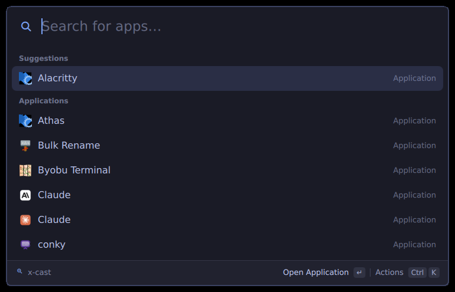
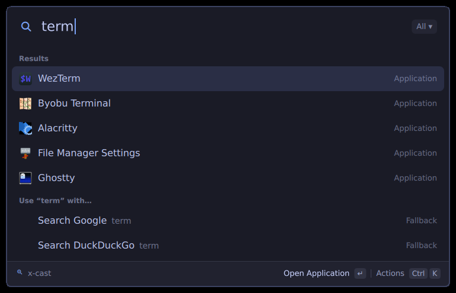
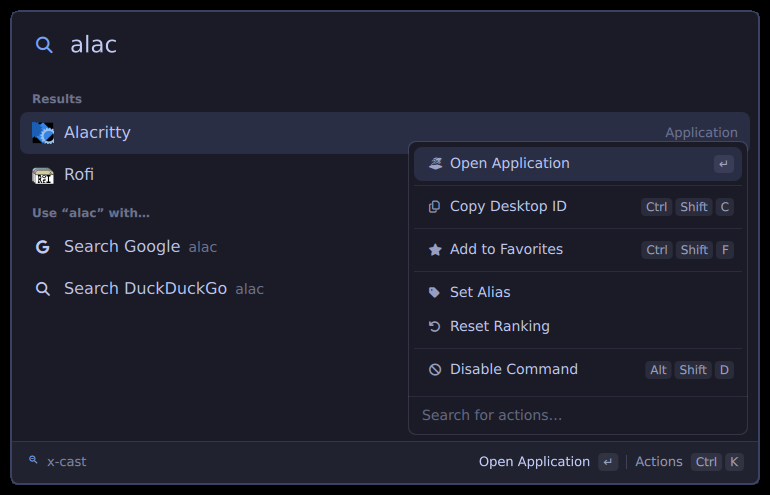
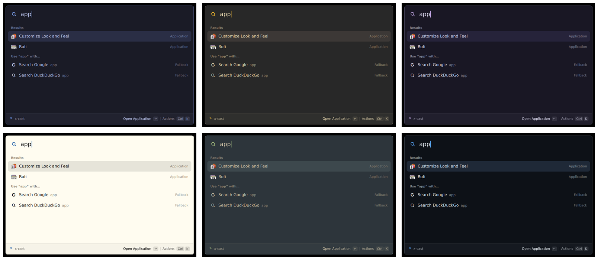

# x-cast

A Raycast-style launcher for X11 window managers (i3). It learns what you use, ranks results with a port of Raycast's root-search algorithm, and is configured with two YAML files.

* **Learns your habits.** Frecency and learned search terms: if you type `ff` and pick Firefox, `ff` keeps meaning Firefox.
* **Your shortcuts.** Give any app an alias, pin favorites, hide what you never use.
* **Keyboard-first.** Ctrl+K action panel, Ctrl+1–9 quick picks, search history on ↑, emacs-style navigation.
* **Light.** Plain Qt (PySide6) with no Electron or Node. The window opens in about 45 ms.

<p align="center"></p>

<table>
  <tr>
    <td width="50%"></td>
    <td width="50%"></td>
  </tr>
  <tr>
    <td align="center"><b>Ranked search with web fallbacks</b></td>
    <td align="center"><b>Ctrl+K: actions for any result</b></td>
  </tr>
</table>

Six themes from `theme.yaml` (the palettes are in `docs/capture.sh`):



## Install

Needs Python 3.11+, `nc` (netcat-openbsd), `xclip`, `xdg-open` and `notify-send`.

```sh
git clone https://github.com/ll931217/i3-cast.git && cd i3-cast
uv sync
bin/x-cast setup i3      # symlink ~/.local/bin/x-cast, bind $mod+d (your old $mod+d line is commented out)
bin/x-cast doctor        # check the pieces
```

Reload i3, then press `$mod+d`. The host starts on first use and stays running.

## Configure

`~/.config/x-cast/config.yaml` and `theme.yaml` are created with every option and its default on first run. Saved changes apply live.

```yaml
# config.yaml
general:
  window_mode: compact      # expanded | compact
  ui_zoom: 1.2
fallbacks:
  - title: Search Kagi
    url: https://kagi.com/search?q={query}
```

```yaml
# theme.yaml
from_alacritty: ~/.config/alacritty/amp.toml   # optional: take the colors from an Alacritty theme
colors:
  background: "#1a1b26"
  selected_text: "#7aa2f7"
font:
  family: Sans
  icon_family: JetBrainsMono Nerd Font
corner_radius: 8
```

## Keyboard

| Key | Does |
|---|---|
| `↵` / `Ctrl+↵` / `Ctrl+Shift+↵` | Run the first, second or third action |
| `Ctrl+K` | Open the action panel |
| `Ctrl+1`…`9` | Pick a result |
| `↑` on an empty search | Search history |
| `Ctrl+↑` / `Ctrl+↓` | Jump between sections |
| `Ctrl+N` / `Ctrl+P` | Next / previous |
| `Ctrl+Shift+F` | Add to favorites (`Ctrl+Alt+↑↓` to reorder) |
| `Ctrl+Shift+C` | Copy desktop id |
| `Alt+Shift+D` | Disable a command |
| `Esc` / `Shift+Esc` | Back / back to root |
| `Ctrl +` / `Ctrl −` / `Ctrl 0` | Zoom |

## CLI

```
x-cast toggle | show | hide
x-cast run app:firefox
x-cast call system.info
x-cast host        # run in the foreground to see logs
x-cast doctor
```

## Develop

```sh
node --test tests/*.test.js   # unit tests for plugin/core
.venv/bin/python -m unittest discover -s tests -p 'test_*.py'
.venv/bin/python tests/qml-integration.py  # isolated offscreen Qt; no live desktop needed
tests/smoke.sh                # live check against the running host (shows and hides the window, never types)
docs/capture.sh               # regenerate docs/screenshots with a throwaway host (types into the launcher after checking focus)
```

Behaviour comes from a static reverse-engineering pass over Raycast; see `SPEC.md` and `reference/`. No Raycast code is included.

## Plugins and settings

- Drop a Python file in `~/.config/x-cast/plugins/` to add commands. See [docs/plugins.md](docs/plugins.md).
- A calculator is built in. Type `2+2`, `sqrt(16)*3`, `20% of 50` or `100 + 10%` and the answer shows above the results. The selected answer also shows in large type on the right, and copied calculations stay in a History list (last 20, in `~/.local/share/x-cast/calculator-history.json`). Enter copies it. For degrees, set `plugins: {calculator: {angle_unit: degrees}}` in `config.yaml`.
- Script Commands (Raycast format) work out of the box from `~/.config/x-cast/script-commands`.
- `x-cast settings` opens the settings window (also the "x-cast Settings" command). A value set in `config.yaml` wins and locks its row.
- Tab moves into argument pills. Ctrl+P opens the type filter. Ctrl+T opens the toast's actions.
- `navigation_bindings: vim-motions` gives Ctrl+J/K/H/L. The action panel then moves to Ctrl+Shift+K.
- Hotkeys: list `hotkeys: {"<commandId>": "$mod+Shift+f"}` in `config.yaml`, then run `x-cast setup hotkeys`. It writes `~/.config/x-cast/i3-hotkeys.conf`, includes it from your i3 config and reloads i3.
- Links: `x-cast setup links` registers `x-cast://run/<id>`, `x-cast://settings`, `x-cast://search?q=...` and `.rayconfig` files (`x-cast open <link>`). `raycast://extensions/<owner>/<ext>/<command>?arguments=...` and `raycast://script-commands/<command>` run the local command whose title has the same slug (`Say Hello` is `say-hello`), with the arguments given by name (`argument1`..`argument3`) or as an array. If nothing matches, or a required argument is missing, the launcher opens with the name as the query. Other `raycast://` links (built-ins like `confetti`) are refused, because x-cast has no Raycast extension runtime.
- `x-cast import file.rayconfig` imports the general settings from a Raycast export. Encrypted exports are refused; export again without a password. Quicklinks, snippets, notes and the rest are reported as not imported.
- With `from_alacritty`, the card outline uses the Alacritty cursor color.
